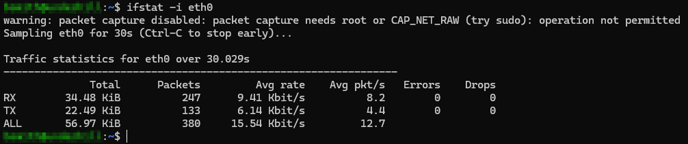
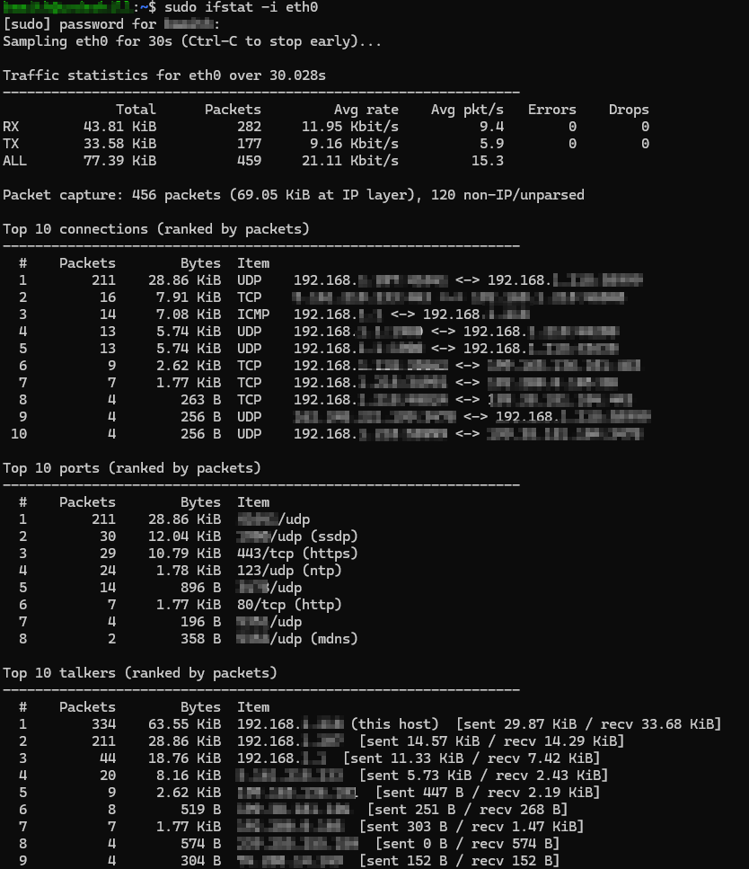

# ifstat

This program looks at an interface and reports on traffic statistics there.  What you get depends on whether you run the program with Super User privileges.  For example:

If the application is run with sudo (or run as root), one will also get a report with the above -and- Top Connections, Top Ports, and Top Talkers, each sorted by number of packets.

## Requirements

- go 1.21
- Linux (this is the only OS I have tested the application on- if you try it on others, please let me know how it went!)

## Running

- go build -o ifstat .

## Command options (CLI)

| Flag                  | Description                                                   |
|-----------------------|---------------------------------------------------------------|
| `-d duration`         | sample duration (e.g. 10s, 1m, 2m30s) (default 30s)           |
| `-i string`           | network interface to monitor (e.g. eth0)                      |
| `-interval duration`  | print live per-interval rates every N (e.g. 5s); 0 disables   |
| `-list`               | list available interfaces and exit                            |
| `-no-capture`         | skip packet capture (counters only; no root needed)           |
| `-no-local`           | omit this interface's own addresses from the top talkers      |
| `-sort string`        | rank top-N tables by "packets" or "bytes" (default "packets") |
| `-top int`            | number of entries in each top-N table (default 10)            |

## License

- This is released under the MIT license.  Use it as you will, but you must give me credit.
